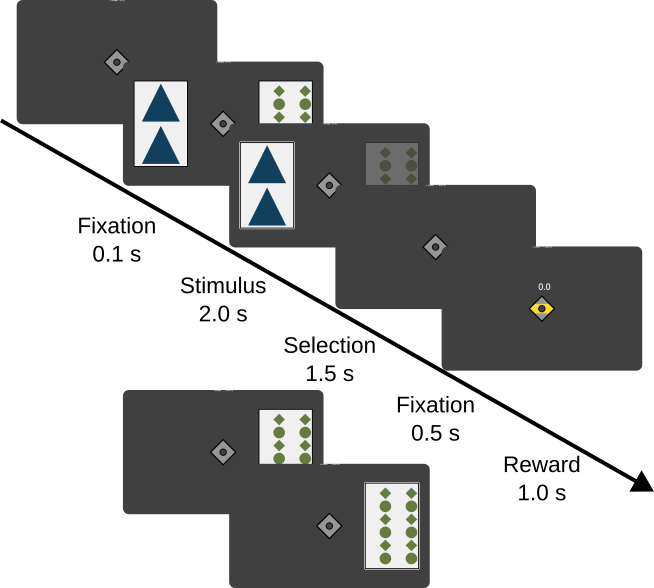

# Risk-sensitive decision making task

## Task description

This task is an implementation of the risk sensitive decision making task introduced by Niv et al.[^niv2012],
using a version similar to the task used in Rosenbaum et al.[^rosenbaum2022].
In this task, participants select card stimuli on a computer screen, which yield them different levels of reward.
There are two types of trials in this experiment:
Classical conditioning trials, where participants are forced to select a single card that is on the screen. And instrumental conditioning
trials, where participants can select between two different cards.
In total there are 5 different cards, that are procedurally generated using different colors, patterns, and shapes.
Each card is associated with a different value: Card # 1 has a certain outcome of 0, # 2 a certain outcome of 20 # 3 a certain outcome of 40,
card # 4 has an outcome of 40 or 0 with 50 % probability, and card # 5 has an outcome of 80 or 0 with 50 % probability.

There were 183 trials in the experiment, and the order in this experiment was pseudorandomly generated, so that each block of 61 trials contains the following:
* 14 trials with an equal expected value (e.g., 20 certain versus 40 with 50 \% probability), left / right counterbalanced and each pair appears 7 times.
* 8 trials with an unequal expected value 20 certain vs. 80 with 50 \% probability.
* 25 forced trials, where only 1 stimulus can be selected, left / right counterbalanced. Each stimulus 5 times per block
* 14 test trials, where one outcome is clearly better (e.g., 20 certain versus 0 certain or 0 certain vs 20 with 50 \% probability)

Blocks were created by randomly permuting the trials in each block and accepting the order only if at least one forced trial of each stimulus appeared in the first 10 trials of a block, forced trials of the same stimulus did not follow each other, risky trials did not follow each other and test trials did not follow each other.

A trial in the experiment had the following order first a fixation cross was shown on the screen for 0.1 s, followed by the appearance of either two stimulus (instrumental conditioning trial) on the left and right side of the fixation cross or a single stimulus on either the left or right side. The appearance initiated response window after 0.05 s and participants had 2 s to select the stimulus. After a response using either the index finger (left stimulus) or the middle finger (right stimulus) the non-selected stimulus was greyed out for 1.5 s, afterwards the stimuli disappeared both and only the fixation cross remained on the screen (0.5 s). After this short delay, the outcome was indicated by the top part of the fixation cross turning green (win) or the middel part turning yellow (0 outcome). The outcome amount was displayed above the fixation cross as a number (e.g. 0 or +20), this was displayed for 1 s. During the inter-trial interval only a fixation cross is displayed. The intertrial interval was sampled for each trial from the set $[0.5 s, 0.75 s, 1.0 s, 1.25 s, 1.5 s]$. Additionally, the time not used in the response window, was added to the time between trials, to create trials of equal length.

Throughout the experiment a gauge was shown on top of the screen, that indicated how many points the participant had gained towards the max payout of 75 DKK. Each outcome, thus moved the bar further towards the right side as a proportion of $\frac{points} / {totalpoints}$. The bar was updated at reward reward outcome as well.

If participants did not press a button in the 2 s response window, the message 'Please respond faster!' was displayed for 1 s on the screen.

Ater 61 and 122 trials, there are 40 s breaks, to allow participants to rest their eyes in the scanner.

Probabilistic rewards were generated pseudorandomly, by permuting lists of length 10 (e.g. [40, 40, 40, 40, 40, 0, 0, 0, 0, 0]), removing the reward from the list and selecting the next one. After selecting a stimulus 10 times, a new randomly permuted list was generated.

## References

[^niv2012]: Niv, Y., Edlund, J. A., Dayan, P., & O’Doherty, J. P. (2012). Neural Prediction Errors Reveal a Risk-Sensitive Reinforcement-Learning Process in the Human Brain. Journal of Neuroscience, 32(2), 551–562. https://doi.org/10.1523/JNEUROSCI.5498-10.2012

[^rosenbaum2022]: Rosenbaum, G. M., Grassie, H. L., & Hartley, C. A. (2022). Valence biases in reinforcement learning shift across adolescence and modulate subsequent memory. eLife, 11, e64620. https://doi.org/10.7554/eLife.64620
